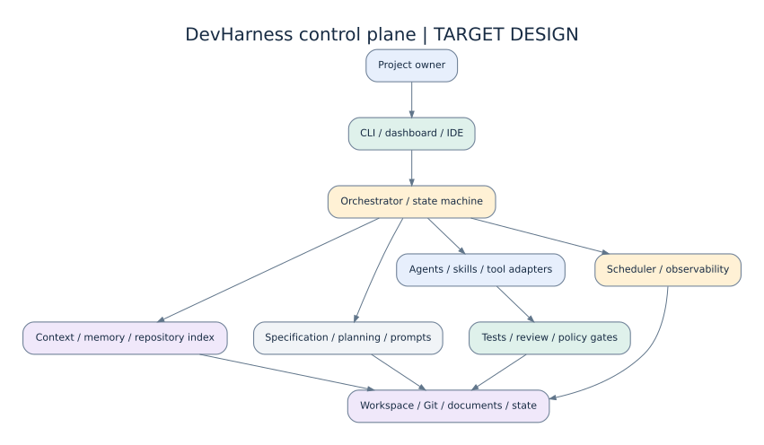

# DevHarness OS

Reusable agentic engineering harness • v0.1 starter • advisory routing and controlled verification.



## Quick start
Python 3.10+; Git optional for local init; Graphviz only for regenerating images.

```powershell
python harness.py doctor
python harness.py init --project ../../my-project
# place authorized files in my-project/docs/00-original
python harness.py ingest --project ../../my-project
python -m unittest discover -s tests -v
python scripts/validate.py
python scripts/validate_techniques.py
python scripts/validate_routing.py
python scripts/validate_execution.py
python scripts/validate_tool_manifest.py
# provide a task JSON object with explicit routing facts
python harness.py route --task task.json --output route.json
python harness.py compile --task route.json --output compiled.json
python harness.py context --task context.json --output context-manifest.json
# inspect scope and run only a reviewed, approved task contract
python harness.py scope --task task-contract.json --output scope.json
python harness.py verify --task task-contract.json --output verification.json
python harness.py capabilities
```

The example destination is outside the Ecomdy checkout when this harness is run from `Ecomdy/.harness/`. Choose a different destination as needed; never initialize a workspace inside a public repository by accident. If this is a standalone harness clone rather than the embedded `.harness/` directory, set `--project` to a path outside that checkout.

Open the generated `docs/01-project-context/CONTEXT_UPDATE_PROMPT.md` in your coding agent with access to the workspace. The CLI inventories and hashes files; it does not parse or extract content, call models, implement tasks or schedule jobs yet. No secrets required. Existing files are preserved on init, except new ignore entries may be appended. `ingest` refuses to overwrite an existing generated registry or prompt unless `--overwrite` is explicitly supplied.

## Documentation
- [Master vision](docs/01-vision.md)
- [Capabilities, agents, skills and tools](docs/02-registries.md)
- [Workflows and loops](docs/03-workflows.md)
- [Development roadmap](docs/04-roadmap.md)
- [Engineering technique library](docs/05-technique-library.md)
- [Technique routing, profiles and recipes](docs/06-technique-routing.md)
- [Execution traces and checkpoints](docs/07-execution-traces-and-checkpoints.md)
- [Technique implementation roadmap](docs/08-technique-implementation-roadmap.md)
- [Benchmark and portability protocol](docs/09-benchmark-and-portability.md)
- [Tool installation, activation and verification](docs/10-tool-installation-and-activation.md)
- [Diagram catalogue](docs/diagrams/README.md)
- [Contribution protocol](CONTRIBUTING.md)

Future capabilities are proposals, not features already implemented. The technique/routing registries, deterministic advisory router, recipe compiler, local context manifest compiler, capability doctor and trace contracts are implemented validators or local advisory tools, not an autonomous runtime. `route` returns `RECOMMENDED`/`NOT_EXECUTED`; `compile` returns `COMPILED`/`NOT_EXECUTED`; `context` records local file metadata without embedding content; `capabilities` does not prove host-wide availability. `scope` detects changed-path violations but does not prevent an independent agent from editing; `verify` runs only allowlisted command argv after approval and pre/post scope checks, with bounded output and evidence hashes. It is not an OS sandbox, checkpoint/resume system or product implementation runner. Project-specific data must stay outside this reusable repository.
