# Diagram catalogue

All diagrams are target designs, not as-built evidence. Mermaid and DOT are editable; PNG and SVG are rendered from DOT.

**Metadata:** Numbered source files carry diagram IDs, version `0.1`, and target state in source comments. The 12 initial diagrams have local PNG/SVG assets. Supplemental Mermaid files render directly when opened on GitHub; separate PNG/SVG assets were not generated because Graphviz is unavailable. See [GitHub Mermaid rendering](https://docs.github.com/en/repositories/working-with-files/using-files/working-with-non-code-files#displaying-mermaid-files-on-github).

## Workspace bootstrap

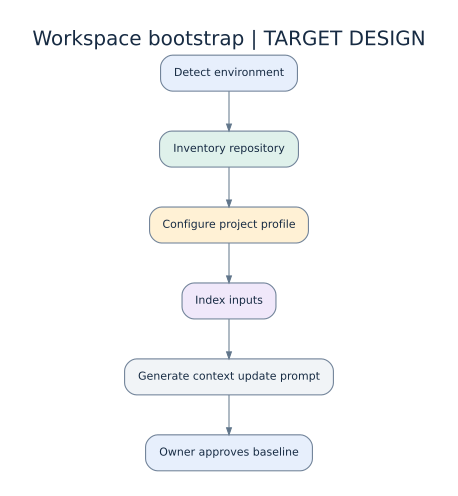

[PNG](01-bootstrap.png) · [SVG](01-bootstrap.svg) · [Mermaid](01-bootstrap.mmd) · [DOT](01-bootstrap.dot)

Mermaid source rendered by GitHub

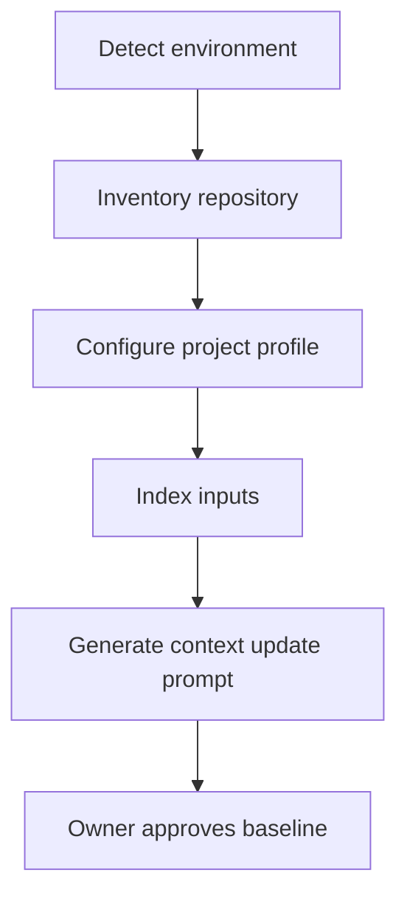

## DevHarness control plane

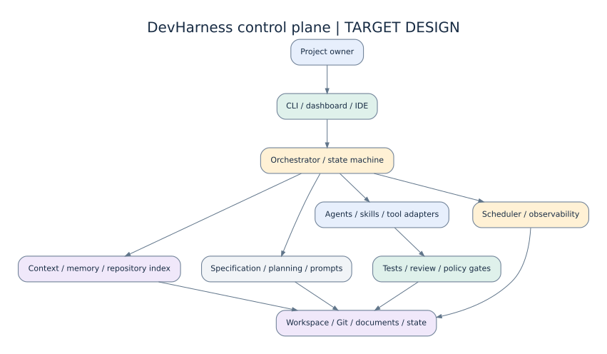

[PNG](02-control-plane.png) · [SVG](02-control-plane.svg) · [Mermaid](02-control-plane.mmd) · [DOT](02-control-plane.dot)

Mermaid source rendered by GitHub

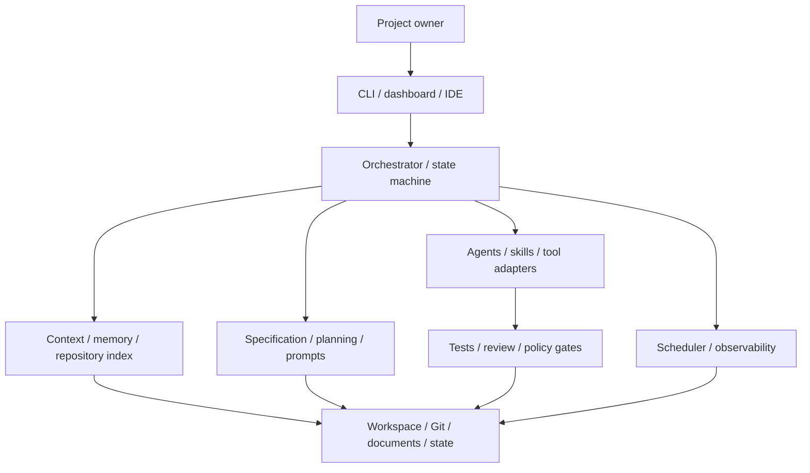

## Progressive context loading

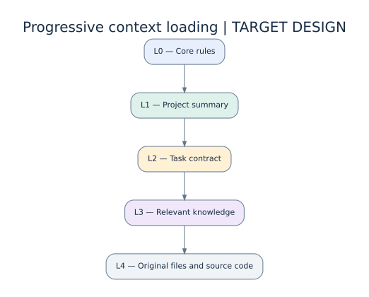

[PNG](03-context.png) · [SVG](03-context.svg) · [Mermaid](03-context.mmd) · [DOT](03-context.dot)

Mermaid source rendered by GitHub

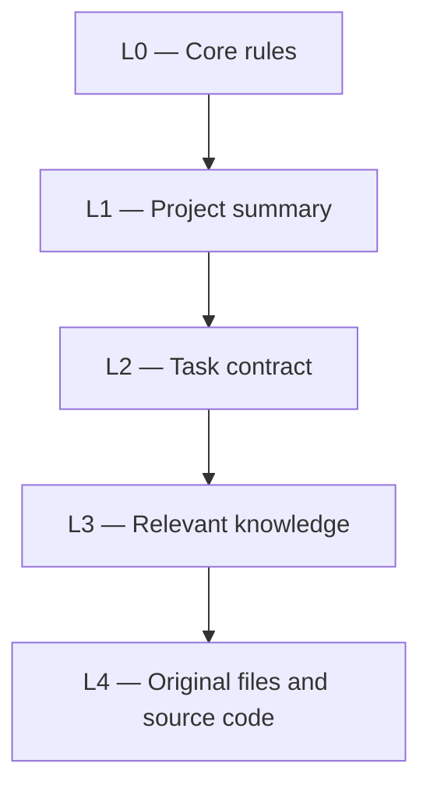

## Document intake

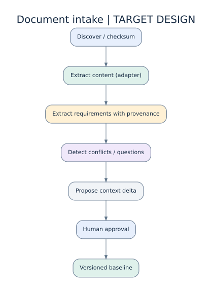

[PNG](04-document-ingestion.png) · [SVG](04-document-ingestion.svg) · [Mermaid](04-document-ingestion.mmd) · [DOT](04-document-ingestion.dot)

Mermaid source rendered by GitHub

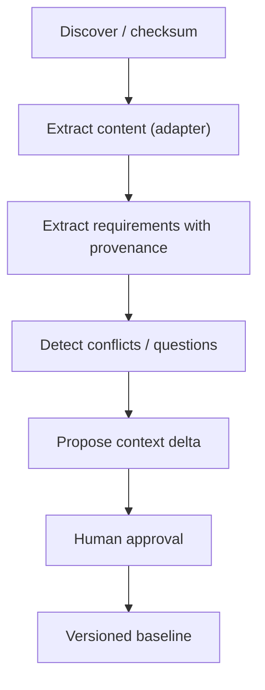

## Agent role routing

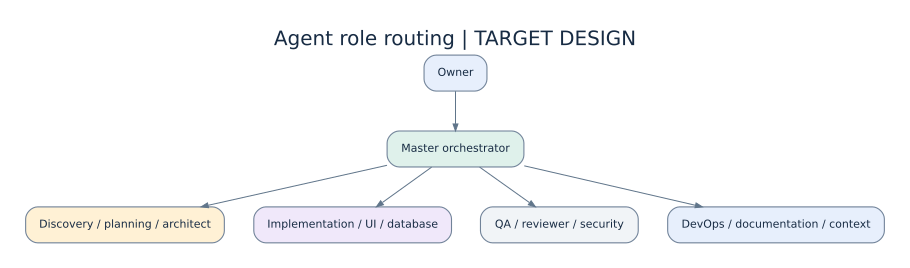

[PNG](05-agent-team.png) · [SVG](05-agent-team.svg) · [Mermaid](05-agent-team.mmd) · [DOT](05-agent-team.dot)

Mermaid source rendered by GitHub

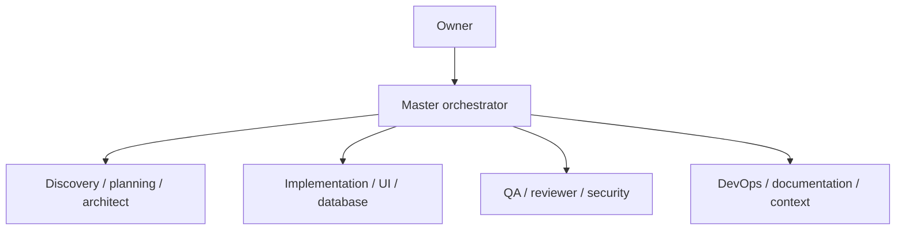

## Bounded Ralph-style execution

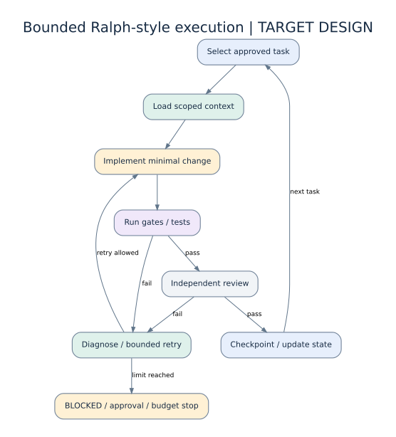

[PNG](06-bounded-loop.png) · [SVG](06-bounded-loop.svg) · [Mermaid](06-bounded-loop.mmd) · [DOT](06-bounded-loop.dot)

Mermaid source rendered by GitHub

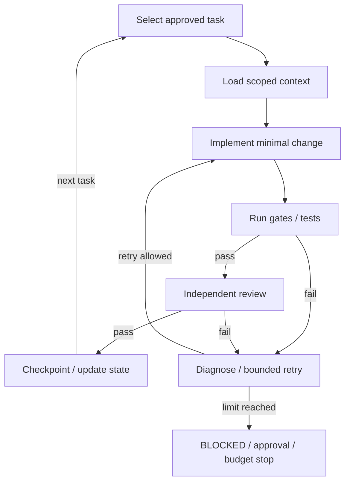

## Planning hierarchy

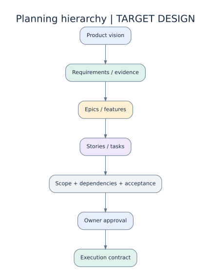

[PNG](07-planning.png) · [SVG](07-planning.svg) · [Mermaid](07-planning.mmd) · [DOT](07-planning.dot)

Mermaid source rendered by GitHub

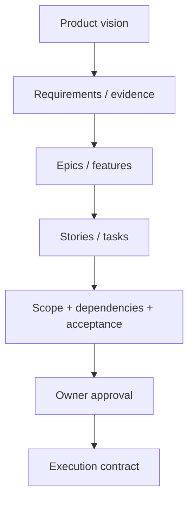

## Verification gates

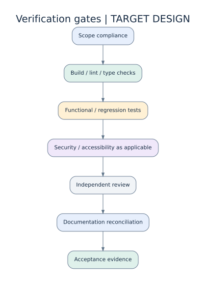

[PNG](08-quality-gates.png) · [SVG](08-quality-gates.svg) · [Mermaid](08-quality-gates.mmd) · [DOT](08-quality-gates.dot)

Mermaid source rendered by GitHub

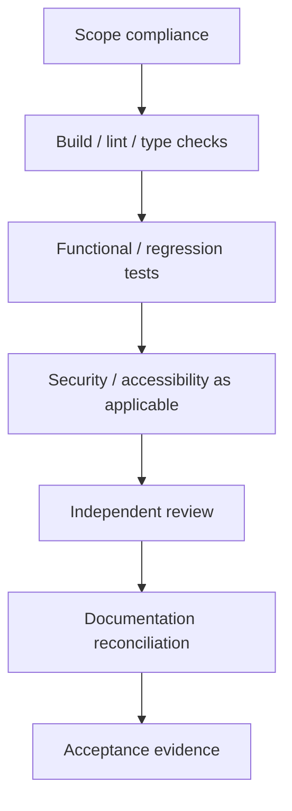

## Harness improvement loop

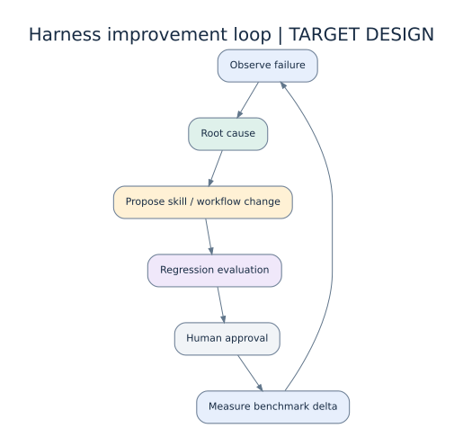

[PNG](09-learning.png) · [SVG](09-learning.svg) · [Mermaid](09-learning.mmd) · [DOT](09-learning.dot)

Mermaid source rendered by GitHub

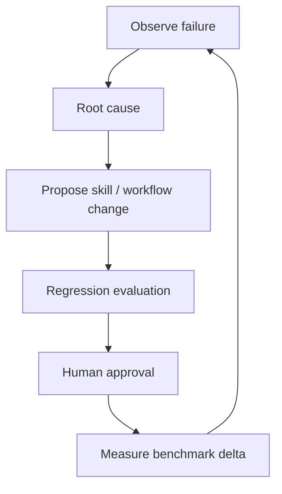

## Diagram skill pipeline

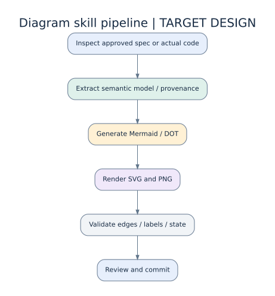

[PNG](10-diagram-pipeline.png) · [SVG](10-diagram-pipeline.svg) · [Mermaid](10-diagram-pipeline.mmd) · [DOT](10-diagram-pipeline.dot)

Mermaid source rendered by GitHub

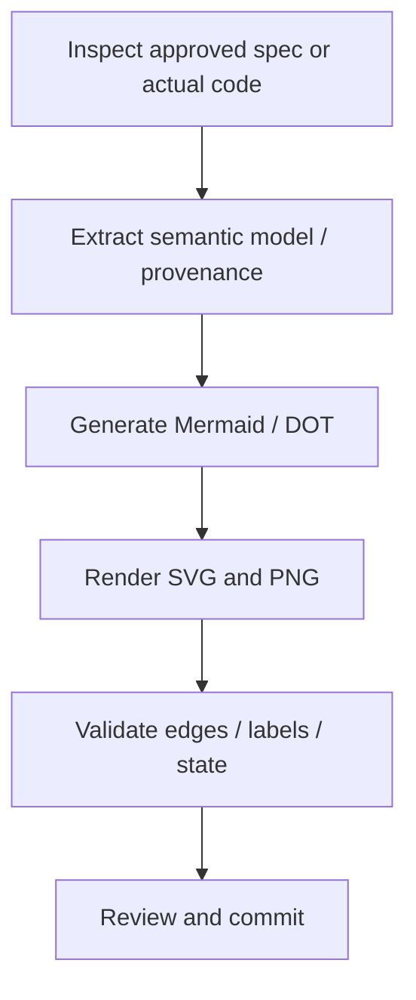

## Scheduled development jobs

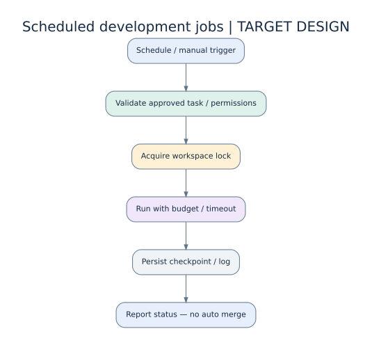

[PNG](11-automation.png) · [SVG](11-automation.svg) · [Mermaid](11-automation.mmd) · [DOT](11-automation.dot)

Mermaid source rendered by GitHub

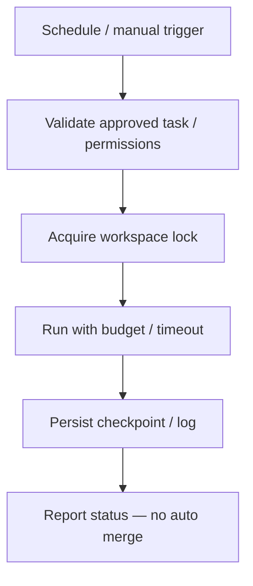

## Harness roadmap

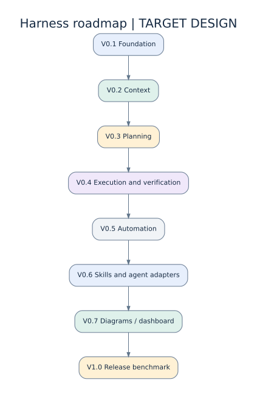

[PNG](12-roadmap.png) · [SVG](12-roadmap.svg) · [Mermaid](12-roadmap.mmd) · [DOT](12-roadmap.dot)

Mermaid source rendered by GitHub

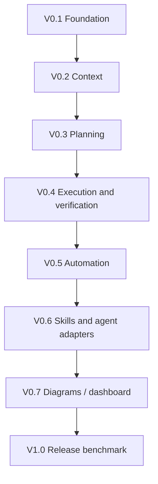

## Additional harness architecture and workflow diagrams

These sources fill the component, memory, skill/tool, prompt, dependency, review, approval, recovery, security, and CI/CD gaps. Each Mermaid file includes ID, version, and target-state metadata and renders on GitHub when opened.

| ID | Diagram | Editable / rendered Mermaid source |
|---|---|---|
| HARNESS-D13 | Harness Component Architecture | [13-component-architecture.mmd](13-component-architecture.mmd) |
| HARNESS-D14 | Memory and Context Layers | [14-memory-architecture.mmd](14-memory-architecture.mmd) |
| HARNESS-D15 | Skill Loading Mechanism | [15-skill-loading.mmd](15-skill-loading.mmd) |
| HARNESS-D16 | Tool and MCP Integration | [16-tool-mcp-integration.mmd](16-tool-mcp-integration.mmd) |
| HARNESS-D17 | Prompt Compilation Pipeline | [17-prompt-compilation.mmd](17-prompt-compilation.mmd) |
| HARNESS-D18 | Task Dependency Graph | [18-task-dependency-graph.mmd](18-task-dependency-graph.mmd) |
| HARNESS-D19 | Bounded Debugging Workflow | [19-debugging-workflow.mmd](19-debugging-workflow.mmd) |
| HARNESS-D20 | Independent Review Workflow | [20-independent-review.mmd](20-independent-review.mmd) |
| HARNESS-D21 | Human Approval Boundaries | [21-human-approval.mmd](21-human-approval.mmd) |
| HARNESS-D22 | Checkpoint and Resume Workflow | [22-checkpoint-resume.mmd](22-checkpoint-resume.mmd) |
| HARNESS-D23 | Security and Permission Boundaries | [23-security-permissions.mmd](23-security-permissions.mmd) |
| HARNESS-D24 | CI/CD Validation and Release Boundary | [24-ci-cd-pipeline.mmd](24-ci-cd-pipeline.mmd) |
