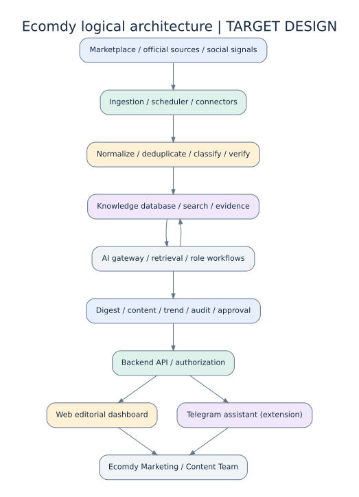

# Ecomdy Intelligence Platform

**AI-Powered Cross-Border Commerce Intelligence & Content Platform**
Greenwich Industry Challenge 2026 × Ecomdy · Challenge 2

> **Current state:** public documentation and target-design repository. No Ecomdy application, API, database, AI integration, scheduled collector, or deployment is implemented here. Phase 0 verdict: **conditional acceptance of the setup baseline only**.

The challenge is to help Ecomdy's Marketing / Content Team research international marketplace, tax, and shipping developments for Vietnamese cross-border sellers; produce evidence-linked weekly digests and channel-specific content drafts; and identify published content that may need updating. Product decisions and implementation status must remain traceable to evidence.

## Contents

- [Product context and official requirements](docs/project-context.md)
- [Product Requirements Document](docs/product-requirements.md) · [Software Requirements Specification](docs/software-requirements-specification.md) · [Project Constitution](docs/project-constitution.md)
- [Requirements register](docs/01-requirements.md) · [traceability](docs/requirements-traceability.md)
- [Product vision and capability registry](docs/02-product-vision.md)
- [Module specifications](docs/module-specifications.md) · [database design](docs/database-design.md) · [API design](docs/api-design.md)
- [Security and governance](docs/security-governance.md) · [risk register](docs/risk-register.md) · [Definition of Ready / Done](docs/definition-of-ready-done.md)
- [Agent and tool registry](docs/agent-tool-registry.md) · [automation](docs/automation-specification.md) · [context engineering](docs/context-engineering.md)
- [Target architecture and candidate stack](docs/03-architecture.md) · [Phase 1 requirements delta](docs/phase1-requirements-delta.md) · [Phase 1 architecture delta](docs/phase1-architecture-delta.md)
- [First vertical-slice plan](docs/vertical-slice-01-plan.md) · [VS01 owner approval pack](docs/vs01-owner-approval-pack.md) · [team development readiness](docs/team-development-readiness.md) · [Phase 1 transition checkpoint](docs/setup/PHASE_1_TRANSITION.md)
- [Technology and harness evaluation](docs/technology-evaluation.md)
- [Business and technical workflows](docs/04-workflows.md)
- [Implementation roadmap](docs/05-roadmap.md)
- [Sprint planning](docs/sprint-planning.md) · [product task register](docs/task-register.md)
- [Testing and evidence strategy](docs/06-validation.md)
- [Constraints and assumptions](docs/constraints-assumptions.md) · [conflict report](docs/conflict-report.md) · [open questions](docs/open-questions.md)
- [Source registry](docs/source-registry.md) · [Ecomdy diagram gallery](docs/diagrams/README.md)
- [Documentation portal](docs/README.md)
- [Comprehensive project audit](docs/setup/COMPREHENSIVE_AUDIT.md) · [repository map](docs/repository-map.md) · [Project Owner guide](docs/project-owner-guide.md)
- [Phase 0 acceptance](docs/setup/PHASE_0_ACCEPTANCE.md) · [capability matrix](docs/setup/CAPABILITY_COVERAGE.md) · [Jira setup plan](docs/setup/JIRA_SETUP_PLAN.md)
- [Developer onboarding and playbook](docs/developer-onboarding.md) · [deployment strategy](docs/deployment-strategy.md) · [DevHarness diagram gallery](.harness/docs/diagrams/README.md)
- [Target user guide](docs/user-guide.md)
- [Environment and capability audit](docs/setup/00_ENVIRONMENT_AND_CAPABILITY_AUDIT.md)
- [Contribution protocol](CONTRIBUTING.md) · [Agent instructions](AGENTS.md) · [Security policy](SECURITY.md) · [Changelog](CHANGELOG.md)

## Problem and intended users

The official brief describes frequent marketplace, tax, and shipping changes, time-consuming research across sources, and outdated published articles. The direct users are the Ecomdy Marketing / Content Team. Vietnamese sellers who sell internationally are the intended beneficiaries. Seller interviews and current Ecomdy process measurements are still outstanding; no user research findings or productivity gains are claimed.

## Challenge capabilities

1. Monitor permitted public sources for marketplace, tax, and shipping news.
2. Produce a weekly seller-focused digest with a source link for each item.
3. Create cited website, social, and short-form video drafts.
4. Flag outdated or inaccurate claims in published articles.
5. Keep all generated content in draft until a person reviews and approves it.

Social-trend intelligence, Telegram, model routing, frequent updates, and multi-market expansion are proposals for later validation, not confirmed MVP requirements.

## Target system architecture

The proposed design separates source ingestion, processing, evidence storage, AI-assisted analysis, application services, API, and user interfaces. It favors a modular product with background work; it does not require each module to be a microservice. DevHarness OS is packaged under `.harness/` as separate development infrastructure and is not an Ecomdy runtime dependency.



All diagrams describe a **target proposal**, not an as-built system. See [Architecture](docs/03-architecture.md), [workflow catalogue](docs/diagrams/README.md), and [DevHarness boundary diagram](docs/diagrams/11-harness-boundary.svg).

## Core workflow proposals

- **Collection:** permitted source → fetch with limits → normalize and deduplicate → classify and retain provenance → verify claims → store evidence.
- **Digest:** select eligible evidence → write summaries with source links → check unsupported claims → human review.
- **Content:** choose an event → generate channel drafts → verify claims and citations → review and edit → approve an exact version.
- **Freshness audit:** authorized published article → extract claims → compare with newer evidence → flag for human review.

These workflows are specifications only; none currently runs as a product service.

## Repository structure

Representative, abbreviated view; see [the documentation portal](docs/README.md) for the full index.

```text
.
├── .github/                 # Pull request / CI configuration
├── .harness/                # Reusable advisory development harness
├── docs/
│   ├── 00-original/          # Local originals; Git-ignored except README
│   ├── diagrams/             # Editable DOT/Mermaid plus SVG/PNG renderings
│   ├── 01-requirements.md
│   ├── 02-product-vision.md
│   ├── 03-architecture.md
│   ├── 04-workflows.md
│   ├── 05-roadmap.md
│   ├── 06-validation.md
│   ├── module-specifications.md, database-design.md, api-design.md, …
│   └── setup/                # Audit, plan, status, decisions, verification, handoff
├── prompts/                  # Bootstrap prompt
├── scripts/                  # Documentation validation and diagram rendering
└── project-profile.json      # Proposed project profile
```

## Technology direction

No stack has been approved. Current documentation evaluates candidates such as React/Next.js, Python/FastAPI, PostgreSQL, background workers, and provider adapters. Select technology only after checking existing code (none was supplied), requirements, source constraints, team skills, operating cost, and deployment needs.

## Current implementation status

| Area | State |
|---|---|
| Product vision, requirements, proposed workflows and architecture | Documentation present; owner validation pending |
| Diagrams | 56 Mermaid sources and 26 static DOT/SVG/PNG sets; bounded parser extraction passed 56/56 sources after a one-line quoted-label compatibility fix (482 nodes, 499 edges, zero dangling edges), Mermaid/DOT parity passed 26/26 on unchanged paired inputs, and static assets passed 26/26; no Mermaid source was rendered locally; Diagram Design Plugin 2.6.131 generated and exported an isolated smoke flowchart; all repository diagrams remain target design |
| Documentation validator | Implemented as `python scripts/validate.py`; run locally or in CI |
| GitHub Actions | Documentation and harness validation workflow present; push and PR checks passed for the audited setup baseline |
| Ecomdy application and runtime | Not implemented |
| DevHarness OS | Bundled under `.harness/` as an advisory starter; independent from Ecomdy runtime; config/scope/budget enforcement not implemented |
| Jira delivery system | Blocked pending owner-authorized Jira access; no Jira data fabricated |
| Seller interviews, team feedback, benchmarks | Outstanding; no results claimed |

## Operational readiness

The repository is usable now for controlled documentation, diagram-source and advisory-harness work. It is not yet usable for product development, live collection, paid AI or deployment. The table below is the direct entry point; each detailed guide is one click away.

| Topic | Current reality | What to do / detailed guide |
|---|---|---|
| Project purpose | Evidence-linked marketplace, tax and shipping intelligence for Ecomdy's Marketing / Content Team | Read [product context](docs/project-context.md) and [official requirements](docs/01-requirements.md). |
| Actual implementation status | Documentation, diagrams, validators and a three-command harness only; no product runtime | Use the [capability matrix](docs/setup/CAPABILITY_COVERAGE.md) and [comprehensive audit](docs/setup/COMPREHENSIVE_AUDIT.md); never describe a proposal as implemented. |
| Product target state | Modular monolith plus bounded worker/scheduler; deterministic evidence processing before AI assistance | Review [target architecture](docs/03-architecture.md) and [Phase 1 architecture delta](docs/phase1-architecture-delta.md). |
| Development architecture | Git/GitHub PR stack, documentation CI, local validators, advisory `.harness/`, manual Jira-ready backlog | Follow [repository map](docs/repository-map.md) and [contribution protocol](CONTRIBUTING.md). |
| Product workflows | Collection, normalization, verification, digest, content approval and freshness audit are specifications only | Use the [workflow catalogue](docs/04-workflows.md); do not run a product workflow that has no implementation. |
| Development workflows | Task contract → scoped branch → implementation/docs → deterministic checks → review → handoff | Follow the [developer operations matrix](docs/developer-operations.md) and [developer playbook](docs/developer-onboarding.md). |
| Repository structure | `docs/` is specification/evidence, `.harness/` is advisory tooling, `scripts/` contains working validators/renderer, no application tree exists | Navigate with the [repository map](docs/repository-map.md). |
| Clone and setup | Default `main` is not ready; acceptance-branch clone passes documentation/harness checks | Use the branch-specific Quick Start below and [onboarding](docs/developer-onboarding.md). |
| AI coding agent configuration | `AGENTS.md` defines scope and stop rules; DevHarness does not route roles or enforce budgets automatically | Read [AGENTS.md](AGENTS.md) and the [agent configuration procedure](docs/developer-operations.md#2-configure-the-coding-agent). |
| Available skills and tools | Three manual harness instruction files; user-level Diagram Design plugin; tool candidates are not automatically installed | Use the [skill/tool map](docs/developer-operations.md#skill-and-tool-map) and [technology evaluation](docs/technology-evaluation.md). |
| Actual working commands | Validators, 3 harness tests, compile check, `init`, `ingest`, `doctor`; Graphviz renderer only when Graphviz exists | Run the [verified command set](docs/repository-map.md#4-executable-behavior-map). |
| Jira and GitHub workflow | GitHub owns source/review/CI; Jira is intended delivery tracker but access is blocked; 39 CSV records are import-ready | Follow [Jira setup](docs/setup/JIRA_SETUP_PLAN.md) and [team readiness](docs/team-development-readiness.md). |
| Branching | One task per short-lived branch; PR #2 is stacked on PR #1; no force-push or direct `main` change | Follow [branch/sync procedure](docs/developer-onboarding.md#3-create-a-task-branch) and [contribution protocol](CONTRIBUTING.md). |
| Testing | Three harness unit tests and documentation validators exist; no product tests exist | Run the [verification procedure](docs/developer-onboarding.md#5-run-verification) and record exact results. |
| Diagram generation | Existing DOT/SVG/PNG assets are preserved; Mermaid rendering is not reproducible yet; parser extraction is not rendering | Follow [diagram workflow](docs/developer-onboarding.md#12-diagram-workflow) and [diagram tooling](docs/setup/DIAGRAM_TOOLING.md). |
| Current roadmap | Integrable baseline → accountable delivery → approved slice contract → fixture vertical slice → editorial MVP | Use the [master roadmap](docs/05-roadmap.md#master-roadmap-and-critical-path). |
| Immediate next actions | Owner review/merge of Ready PR #1, real reviewer assignment, Jira authorization and VS01 gate decisions; authenticated governance read-back is complete | Use the [Project Owner guide](docs/project-owner-guide.md), [VS01 approval pack](docs/vs01-owner-approval-pack.md) and [ordered audit plan](docs/setup/COMPREHENSIVE_AUDIT.md#20-ordered-owner-action-plan). |

## Quick start

Default `main` currently contains only a one-line README because PR #1 is unmerged. Until the approved baseline merges, clone the acceptance branch explicitly.

```bash
git clone --branch docs/phase-0-acceptance https://github.com/macxuanhoa/Ecomdy.git
cd Ecomdy
python scripts/validate.py
python .harness/harness.py doctor
python -m unittest discover -s .harness/tests -v
python .harness/scripts/validate.py
```

After the baseline merges and the branch limitation is removed, use the normal default-branch clone documented in the [developer onboarding and playbook](docs/developer-onboarding.md). The acceptance-branch clone passed these documentation/harness checks; it does not provide an Ecomdy application setup.

The documentation validator uses only the Python standard library. It checks local Markdown links and required diagram assets. It does **not** test an application, external links, legal compliance, or diagram semantics.

The reusable harness CLI is also Python-only. See the [Harness Installation Guide](docs/harness-installation-guide.md) for workspace initialization and source inventory commands. Its current `ingest` command inventories and hashes files but does not extract document contents or execute agent tasks.

### Contributing and continuing work

1. Read [Phase 0 acceptance](docs/setup/PHASE_0_ACCEPTANCE.md), [capability matrix](docs/setup/CAPABILITY_COVERAGE.md), [Agent instructions](AGENTS.md), [requirements](docs/01-requirements.md), [current-state audit](docs/setup/00_ENVIRONMENT_AND_CAPABILITY_AUDIT.md), and the relevant specification.
2. Create a task-scoped branch using a real Jira key when available and record scope, dependencies, acceptance checks, budget, stop conditions and evidence. Do not invent Jira keys or team assignments.
3. Inspect existing files before adding code. Preserve current behavior and source provenance.
4. Run only checks that exist and report exact results; do not claim a target workflow is implemented because a design exists.
5. Update requirements traceability, docs, and verification evidence with any behavior change.

For new projects, existing projects, context refresh, or interrupted sessions, use [the documentation portal](docs/README.md), [Harness Installation Guide](docs/harness-installation-guide.md), and [setup handoff](docs/setup/HANDOFF.md). Ecomdy-specific runtime commands do not exist yet.

## Diagrams

The Ecomdy gallery contains 32 target diagram sources; 14 have checked-in DOT plus SVG/PNG assets, and 18 are supplemental Mermaid files. The DevHarness gallery contains 24 target sources; 12 have checked-in DOT plus SVG/PNG assets, and 12 are supplemental Mermaid files. Supplemental Mermaid is intended to render on GitHub, but this behavior was not locally verified. All source files carry diagram ID, version, and state metadata. Update sources in their gallery folder. The three C4-level views use C4-style flowcharts because GitHub's renderer does not bundle the experimental native C4 extension. Regenerate existing DOT renders with `python scripts/render_diagrams.py` where Graphviz is installed; the script invokes Graphviz `dot` directly. Local Graphviz is unavailable in this setup, so existing static images were structurally validated and visually inspected at overview scale, not freshly regenerated. The installed Diagram Design extractor now parses 56/56 Mermaid sources after a semantics-preserving quote around one semicolon-containing edge label; this is parser evidence, not Mermaid rendering. See the [diagram tooling guide](docs/setup/DIAGRAM_TOOLING.md) for the manifest, commands, smoke-test evidence and limits, and the [comprehensive audit](docs/setup/COMPREHENSIVE_AUDIT.md) for historical parser, parity and asset evidence.

## GitHub Actions

The current workflow runs the product documentation validator, DevHarness unit tests, and harness documentation validator on pushes, pull requests, and manual dispatch with read-only repository permissions. It disables persisted checkout credentials, does not deploy or run AI jobs, and uses the current major releases of the official checkout and setup-python actions. Dependabot checks GitHub Actions versions monthly and opens reviewable PRs; no product packages are declared. Repository description, topics, labels, milestones, secret scanning, dependency updates, private vulnerability reporting, and `main` branch protection were configured as recorded in the [setup audit](docs/setup/00_ENVIRONMENT_AND_CAPABILITY_AUDIT.md). Authenticated read-back on 2026-11-28 verified strict `validate` protection on `main`, PR-only and resolved-conversation requirements, admin enforcement, no force-pushes/deletions, no repository rulesets, default read-only workflow permissions, and enabled secret scanning/push protection, Dependabot security updates, vulnerability alerts and private vulnerability reporting. The current protection requires zero approving reviews, but this project still requires an explicit human review before merge. The monthly version-update config activates on `main` after PR #1 merges.

## Security and source handling

- Never commit credentials, API keys, private user data, or unapproved internal materials.
- The original challenge documents remain in `docs/00-original/`, ignored by Git. Do not force-add them.
- Reusable harness workspace originals belong in `.harness/docs/00-original/` and are ignored by Git too.
- Use an owner-reviewed source allowlist and comply with source terms before any collection implementation.
- Keep generated content draft-only until an authorized person approves it.
- Review external-source content as untrusted input; preserve citations and defend against prompt injection.

## Documentation map

See [docs/README.md](docs/README.md) for source authority, requirements, product documentation, diagrams, setup records, and current gaps. See [the setup plan](docs/setup/SETUP_PLAN.md) for task sequencing.
