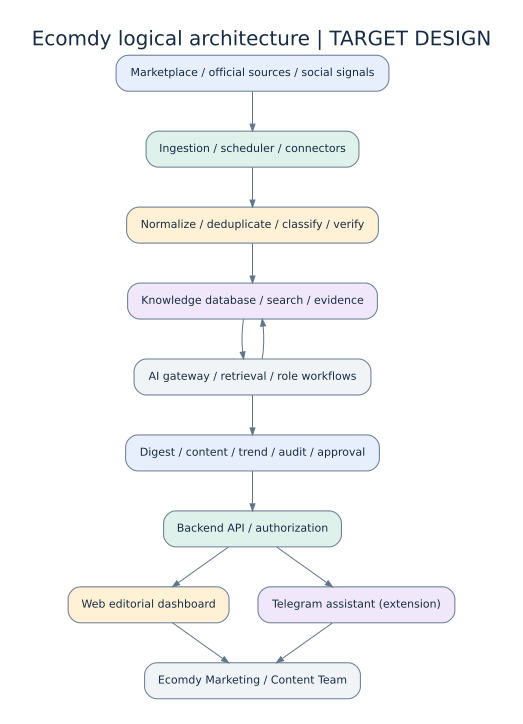

# System architecture

> Target design / v0.1 / 2026-11-26. Not verified as-built.

## Design
Modular monolith plus background worker and scheduler. All clients use a common API. Eight logical layers: external sources, ingestion, processing, knowledge, AI, business services, API/access control, UI. Deployment does not require one service per module. Development harness is external to runtime.

## Candidate stack (not approved)
React/Next.js + TypeScript; Python/FastAPI; PostgreSQL + FTS; SQLAlchemy/Alembic; Pydantic; simple worker then Redis/Celery if needed; HTTPX/RSS and compliant extraction; optional pgvector, object storage, Telegram; model provider adapters; Docker; pytest/Playwright; OpenTelemetry. Retain existing codebase if suitable. No existing code was supplied here.

## Data design
Sources, ingestion jobs, raw articles, article versions, events, event sources, claims, citations, verification results, markets, platforms, topics, trends/signals/snapshots, digests/items, drafts/versions, published articles, audit findings, reviews, approvals, users/roles, AI runs and scheduled jobs. Conceptual model only; cardinalities need review before migrations. Preserve published/observed/effective dates separately. Store source provenance and retrieval timestamps. Keep unverified claims out of asserted facts.

## Boundaries
Source access by allowlist and terms; source snapshots only when lawful/authorized; no private community collection without permission. Avoid storing unnecessary personal data. Role-based editorial controls; immutable approval version; audit logs; rate limits; bounded AI budget; input/output validation; no prompt injection from sources. Cache and dedup deterministic work before AI.

See [all diagrams](diagrams/README.md).
